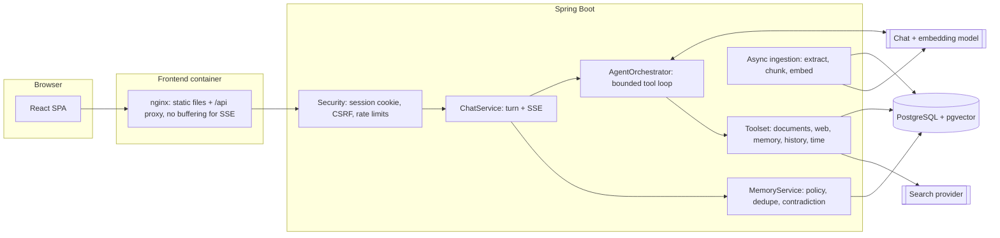

# Agentic RAG Assistant

A full-stack AI assistant that answers from **your uploaded documents**, the **live web** and a **long-term memory** of you. A bounded agent decides which sources it needs, calls them as tools, and writes an answer whose citations link back to the exact passages, pages or URLs it used.

- **Backend:** Java 21, Spring Boot 3.5, Spring AI 1.1, PostgreSQL 17 + pgvector, Flyway, Spring Session (JDBC)
- **Frontend:** React 18, TypeScript, Vite, Tailwind CSS, TanStack Query, react-markdown
- **Runs with:** OpenAI or any OpenAI-compatible API (Groq, OpenRouter, LM Studio, vLLM) or Ollama. Live search via Tavily, Brave or SearXNG.

## Features

| Area | What it does |
|---|---|
| Chat | Streaming answers (SSE) with live progress ("Searching your documents"), stop and regenerate, Markdown with code and tables, feedback, conversation search, rename, archive |
| Modes | **Auto** (the agent chooses), **Documents** (grounded in your files), **Web** (current information), **Chat** (no retrieval) |
| Documents | PDF, DOCX, TXT and Markdown up to 20 MB. Content-type sniffing, async ingestion with progress, chunking with overlap, hybrid retrieval (vector + full-text) |
| Citations | Every source the tools returned is stored with the reply. Citation numbers the model invents are removed before the answer is saved. |
| Memory | Learns durable facts and preferences from your own messages ("My name is…", "Remember that…", "From now on…"). Newer facts replace contradicting ones. Secrets are never stored; sensitive data only when you ask explicitly. You can view, edit, delete or switch it off. |
| Live web | Search with caching and retries, and page reading limited to URLs from the current results, with SSRF protection |
| Accounts | Register, sign in, password reset by email, profile, change password, delete account |
| Admin | Usage stats, users (enable, disable, role), agent execution log, audit log. Never shows message content. |

## Quick start (Docker)

Requirements: Docker Desktop.

```bash
cp .env.example .env
# edit .env: set AI_API_KEY (and ADMIN_EMAILS with your email to get the admin screen)
docker compose up --build
```

Open <http://localhost:3000> and create an account. Upload `docs/samples/orbital-cafe-handbook.md` on the Documents page, then ask in Documents mode: *"What are the opening hours and who do I contact about allergies?"*

**No API key?** Set `AI_PROVIDER=none` and `EMBEDDING_PROVIDER=hash` with `EMBEDDING_DIMENSIONS=384`. Accounts, documents and memory all work, and chat replies explain that no model is configured. Or run a local model with Ollama, as shown in `.env.example`.

> `EMBEDDING_DIMENSIONS` sizes the vector columns when the database is first created. To change it later, run `docker compose down -v` first, which deletes all data.

## Local development

Requirements: JDK 21+, Maven 3.9+, Node 20+, Docker (for PostgreSQL).

```bash
docker run -d --name ara-db -e POSTGRES_DB=agentic_rag -e POSTGRES_USER=agentic -e POSTGRES_PASSWORD=agentic \
  -p 5432:5432 pgvector/pgvector:0.8.1-pg17

cd backend
AI_API_KEY=sk-... mvn spring-boot:run          # http://localhost:8080, Swagger UI at /swagger-ui.html

cd ../frontend
npm install
npm run dev                                     # http://localhost:5173 (proxies /api to :8080)
```

## Configuration

All settings are environment variables (see `.env.example`; defaults are in `backend/src/main/resources/application.yml`).

| Variable | Default | Purpose |
|---|---|---|
| `AI_PROVIDER` | `openai` | `openai`, `ollama` or `none` |
| `AI_BASE_URL`, `AI_API_KEY`, `AI_MODEL` | OpenAI, empty, `gpt-4o-mini` | Chat model |
| `EMBEDDING_PROVIDER` | `openai` | `openai`, `ollama`, `hash` (offline demo) or `none` |
| `EMBEDDING_MODEL`, `EMBEDDING_DIMENSIONS` | `text-embedding-3-small`, `1536` | Must match the model's output size |
| `SEARCH_PROVIDER`, `SEARCH_API_KEY`, `SEARCH_BASE_URL` | `none` | `tavily`, `brave` or `searxng` |
| `ADMIN_EMAILS` | empty | Comma-separated emails that become admins when they register |
| `AGENT_MAX_ITERATIONS`, `AGENT_MAX_TOOL_CALLS`, `AGENT_MAX_DURATION` | `5`, `8`, `150s` | Bounds on each agent run |
| `RAG_TOP_K`, `RAG_SIMILARITY_THRESHOLD`, `RAG_CHUNK_SIZE` | `5`, `0.30`, `1200` | Retrieval tuning |
| `MEMORY_AUTO_EXTRACT` | `true` | Learn from statements. Explicit "remember…" requests always work while memory is on. |
| `RATE_LIMIT_CHAT_PER_MINUTE` | `20` | Per-user limits for chat, uploads and auth |
| `MAIL_HOST` and the other `MAIL_*` | empty | SMTP for password reset. Without it the feature is disabled. |
| `SESSION_COOKIE_SECURE` | `false` | Set `true` behind HTTPS |

## Architecture



**One chat turn**

1. `ChatTurnService.prepare` (short transaction) checks ownership, stores the user message and loads recent history, the rolling summary and the user's settings. A conversation allows one run at a time (`ActiveRunRegistry`).
2. `MemoryExtractionService` saves memories from the user's own words, and `MemoryService` retrieves the relevant ones.
3. `AgentOrchestrator` streams the model's response. When the model requests tools, `ToolExecutor` checks each call against the mode's allow-list, rejects duplicates, enforces timeouts and passes the results back. The loop stops on a final answer, the iteration or tool budget, the deadline, or cancellation. On the last iteration no tools are offered, which forces an answer.
4. Citations are checked against the sources actually registered in the run. `ChatTurnService.complete` stores the reply, its sources and an `agent_executions` record, then a background job refreshes the conversation summary.

SSE events: `meta`, `status`, `tool`, `content`, `reset` (discard a tool-call preamble), `sources`, `done`, `error`.

## API overview

Interactive docs: `/swagger-ui.html` (development) and the OpenAPI JSON at `/v3/api-docs`.

| Endpoint | |
|---|---|
| `POST /api/auth/register`, `/login`, `/logout`, `GET /api/auth/me`, `GET /api/auth/csrf` | Session auth |
| `POST /api/auth/password-reset/request`, `/confirm` | Password reset |
| `GET/PATCH/DELETE /api/users/me`, `POST /api/users/me/password` | Profile |
| `GET/POST /api/conversations`, `GET/PATCH/DELETE /api/conversations/{id}` | Conversations |
| `POST /api/chat/{id}/messages`, `/stream`, `/cancel` | Chat (blocking, SSE, stop) |
| `GET /api/messages/{id}/sources`, `PUT/DELETE /api/messages/{id}/feedback` | Sources and feedback |
| `GET/POST /api/documents`, `GET /api/documents/{id}/status`, `POST /api/documents/{id}/reingest`, `DELETE` | Documents |
| `GET/POST/DELETE /api/memories`, `PATCH/DELETE /api/memories/{id}`, `GET/PATCH /api/memory/settings` | Memory |
| `GET /api/system/status` | Public feature flags |
| `/api/admin/stats`, `/users`, `/executions`, `/audit-logs` | Admin only |

**CSRF:** send the value of the `XSRF-TOKEN` cookie in the `X-XSRF-TOKEN` header on every non-GET request. The token rotates on login, so read the cookie per request. The body of `GET /api/auth/csrf` contains a masked token; it only exists to get the cookie issued.

## Security

- HttpOnly, SameSite=Lax session cookie stored in PostgreSQL. Session id rotated on login, all sessions ended on password reset, account deletion or admin disable. BCrypt (cost 12).
- Every user-owned row is looked up by `(id, userId)`, and other users' ids return 404. Agent tools only receive the server-side identity, never ids chosen by the model.
- Prompt-injection defenses: tool output, documents and web pages are labelled as untrusted data; memories are only created from the user's own messages; page fetching is limited to URLs from the current search results.
- SSRF protection for fetched pages: http(s) only, default ports, public IPs only (loopback, private, link-local and metadata addresses are blocked).
- Uploads are checked by extension and content, with size and per-user limits. Stored outside the web root under UUID-based paths, never the uploaded filename.
- Rate limits on chat, uploads and auth. Errors return safe messages without stack traces. nginx sends CSP, X-Frame-Options and nosniff headers.
- Markdown is rendered without raw HTML. Links open with `rel="noopener noreferrer nofollow"`.

## Testing

```bash
cd backend && mvn test        # needs Docker for Testcontainers
cd frontend && npm test && npm run typecheck && npm run build
```

- **Backend:** unit tests for citation sanitizing, memory extraction and policy, chunking, URL safety and the run registry. `ChatFlowIntegrationTest` boots the full app against pgvector with a scripted `FakeChatModel` and offline embeddings, covering auth and CSRF, chat, SSE, regenerate, document RAG with citations, memory (including contradictions, secrets and opt-out), cross-user isolation, feedback and admin access.
- **Frontend:** SSE parsing, citation linking and Markdown safety.
- **End to end:** `e2e/` drives Chrome through the whole app against a mock OpenAI-compatible server, which exercises the real Spring AI client, streamed tool calls and the agent loop without an API key. See `e2e/README.md`.

## Project structure

```
backend/   Spring Boot service (packages: auth, user, chat, agent, tools, document, rag, memory, search, source,
           feedback, admin, security, config, common, exception); Flyway migrations in src/main/resources/db
frontend/  React SPA (api/, auth/, components/, hooks/, pages/), nginx.conf for the container
docs/      Sample documents
e2e/       Mock OpenAI server and Playwright browser walkthrough
```

## Limitations

- Rate limits and the active-run registry live in memory, so run a single backend instance (or move them to Redis).
- The `hash` embedding provider is lexical only and is meant for offline demos, not real semantic search.
- Scanned PDFs need OCR before upload; only embedded text is extracted.
